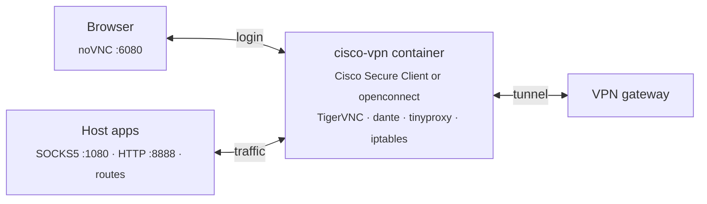

<div align="center">

# cisco-vpn-docker

**Your Cisco AnyConnect VPN in a container: log in from a browser, reach the VPN through SOCKS5, HTTP or a route.**

<sub>official Cisco Secure Client or openconnect · SAML single sign-on in noVNC · the host's own routes, DNS and firewall stay untouched</sub>

<br>


</div>

---



## Tech stack

| | |
| --- | --- |
| **VPN client** | **Cisco Secure Client** (`vpnagentd`, and `vpnui` with its built-in login browser for SAML and MFA), or **openconnect** `--protocol=anyconnect`, chosen at build time by whether `packages/` holds your Cisco package |
| **Login** | **TigerVNC** and **flwm** desktop, **noVNC** and **websockify** in the browser |
| **Proxies** | **dante** SOCKS5 with optional username and password, **tinyproxy** HTTP |
| **Route mode** | **iptables** forwarding and NAT from the Docker network into the tunnel; new TCP connections from the VPN side dropped |
| **Container** | **debian:bookworm-slim**, `NET_ADMIN`, `SYS_ADMIN` and `/dev/net/tun`, no `--privileged`, no host network |
| **Build** | **BuildKit** bind mount keeps `packages/` out of the image; a **GitHub Actions** workflow pushes the Cisco image to your private registry |

## Install

Needs a Linux host (amd64) with Docker, Docker Compose and `/dev/net/tun`.

```bash
git clone https://github.com/Lixsp11/cisco-vpn-docker.git
cd cisco-vpn-docker
cp cisco-secure-client-vpn_<version>_amd64.deb packages/   # Cisco variant; leave packages/ empty for openconnect
printf 'PASSWORD=changeme\nVPN_SERVER=vpn.example.com\n' > .env
docker compose up -d --build
```

Open `http://127.0.0.1:6080/vnc.html` (forward port 6080 over SSH from another machine), log in, then use `127.0.0.1:1080` (SOCKS5) or `127.0.0.1:8888` (HTTP). [docs/usage.md](docs/usage.md) has the details.

<div align="center">
<sub>Built on the ideas of <a href="https://github.com/docker-easyconnect/docker-easyconnect">docker-easyconnect</a>.</sub>
</div>
